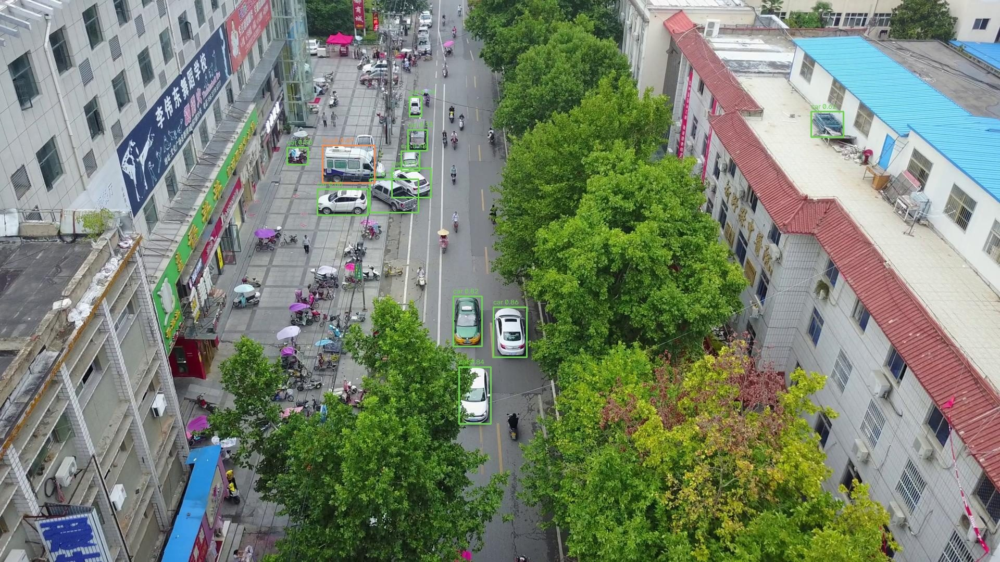
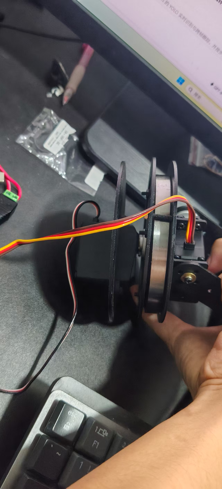
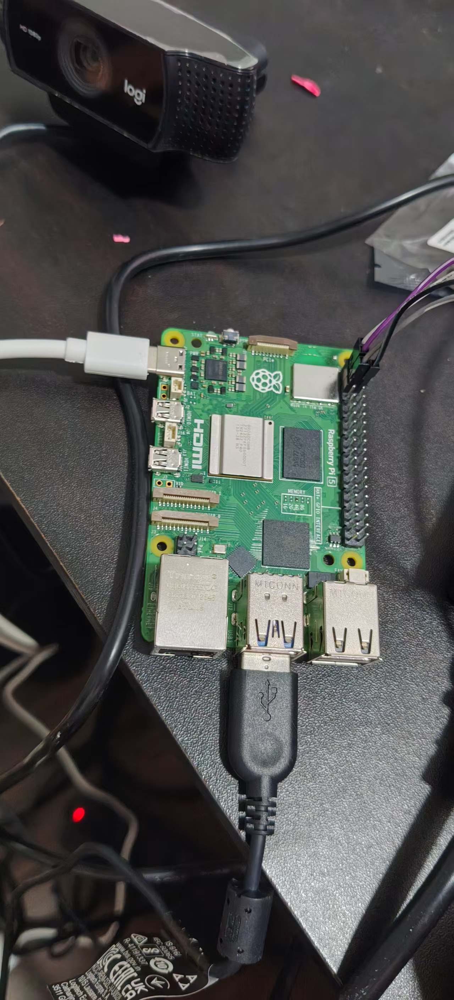
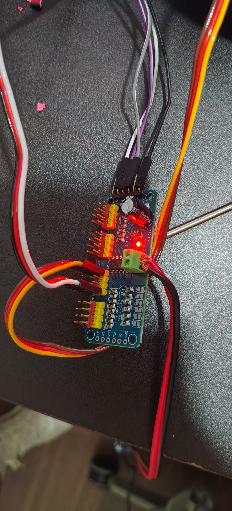

# FLY 无人机视角车辆检测与跟踪

CAT405 Intelligent Computing Major Project。使用预训练 YOLO26l 检测航拍画面中的 car、bus、truck，在录制视频内使用 ByteTrack 关联目标，并通过本地 Web 页面查看结果。

作者：ZHANG XIAOHUI · USM202309040
导师：Dr.Danny Chen Sien Yau
版本：0.2.0-alpha.3 · 开发中

## 当前进度

工作台提供图片检测和视频跟踪两个入口。功能页支持选择或拖入媒体、提交任务、轮询状态、查看标注图片/视频和检测明细，以及下载流水线生成的 CSV、JSON 和媒体文件。界面支持中文和英文。

这是本机单用户离线测试界面。任务历史与评估记录页面仍为占位页面；任务记录只保存在服务进程内存中，重启后不会恢复。取消操作会在推理返回后隐藏产物，不会立即停止计算。筛选、专门的导出流程、帧级播放联动和输入时长/分辨率限制尚未实现。

目前没有完成航拍数据微调、代表性准确率测试或正式系统验收。输入限制、类别规则、模型阈值及性能目标仍需先导验证。开发检查记录见 [验证记录](docs/validation/2026-11-20/README.md)。

## 运行结果示例



这是 2026 年 11 月 19 日的真实本地开发运行结果。另有[视频内跟踪截图与样本说明](docs/showcase/README.md)。样例只说明流水线产生了标注结果，不代表准确率测试或正式验收通过。

## 关联硬件原型：视觉目标检测与舵机云台

另一个独立原型使用 Logitech C922、树莓派 5、PCA9685 和两台 MG996R，探索摄像头画面中的目标位置如何对应云台动作。它与本仓库的航拍车辆检测流程尚未集成。[查看原型代码与详细进展](https://github.com/huhuhujjj/vision-servo-tracker/blob/main/docs/progress.md)。

| 双轴云台 | 树莓派与 C922 | PCA9685 与舵机 |
| --- | --- | --- |
|  |  |  |

目前已验证 C922 经树莓派 Wi-Fi 转发至主机进行实时识别，也分别验证了两台舵机的短时动作。摄像头随云台运动的画面位移、机械行程和视觉闭环跟随仍需验证。

## 环境与启动

已验证的本地环境为 Windows、Python 3.12.14、PyTorch 2.10.0+cu128、Ultralytics 8.4.215。需要 ffmpeg 和 ffprobe 位于 PATH。以下命令从仓库根目录执行，使用 PowerShell：

```powershell
python -m venv model/.venv
model/.venv/Scripts/python.exe -m pip install torch==2.10.0+cu128 torchvision==0.25.0+cu128 --index-url https://download.pytorch.org/whl/cu128
model/.venv/Scripts/python.exe -m pip install -r model/requirements-inference-windows-lock.txt
```

按模型发布方的许可获取 `yolo26l.pt`，放入 `model/weights/`，然后启动：

```powershell
model/.venv/Scripts/python.exe web/backend/run.py
```

打开 <http://127.0.0.1:8765/>。已有环境可直接运行启动命令。该服务只监听本机，不用于公网部署。CUDA 构建也用于当前默认的 CPU 推理；改装 CPU 专用软件包的环境需要单独验证。

上传仅接受 JPEG/PNG 图片和 MP4 视频，文件大小暂限 256 MiB。图片只检测，不分配跟踪 ID；视频的 ID 只在当前运行内有效。轨迹记录的是图像平面上的观测，不代表身份、地理位置或真实速度。

## 测试

后端检查需要专用推理环境、权重和开发样本。样本准备方式见 [离线最小链路](docs/step3_minimal_pipeline.md) 和 `model/scripts/prepare_step3_media.py`；数据与权重不随仓库分发。

```powershell
model/.venv/Scripts/python.exe -m unittest web.backend.test_api -v
```

浏览器测试使用 Playwright。首次安装测试依赖：

```powershell
Set-Location web/backend
npm ci
npx playwright install chromium
Set-Location ../..
model/.venv/Scripts/python.exe web/backend/run_e2e.py
```

测试执行器为六个浏览器脚本分别启动临时本地服务，保存输出和退出码到 `.qa/e2e/`。无需预先启动正常服务。通过 `--node` 可指定 Node.js 路径，通过 `--output` 可指定日志目录。这些检查验证开发样本上的功能流程，不代替精度、性能或十九项系统验收。

## 目录

| 路径 | 内容 |
| --- | --- |
| `web/frontend/` | HTML、CSS、JavaScript 和中英文字典 |
| `web/backend/` | 本地 HTTP API、上传、任务状态和开发测试 |
| `model/src/` | 检测、跟踪、评价与数据规则 |
| `model/scripts/` | 数据审查、样本准备、离线运行及清单工具 |
| `model/configs/` | 范围、类别及先导参数 |
| `docs/` | 提案、需求、设计、开发指南及验证记录 |
| `logs/` | 按日期保留的开发记录 |

## 数据与版本

VisDrone 数据的用途、类别映射和来源审查见 `model/data/sources/` 及 `docs/step2_*`。最终测试清单尚未冻结，许可版本适用性仍需跟进。数据集、模型权重、运行产物、虚拟环境和备份留在本机，Git 记录源码、配置和必要的审查清单。

本仓库未另行授予开源许可证；第三方代码、模型和数据遵循各自的许可。项目不包含直播、飞行控制、地理定位、真实速度、人脸/车牌识别或跨视频身份关联。

文档入口见 [文档总览](docs/文档总览.md)，接口见 [后端说明](web/backend/README.md)，开发记录见 [CHANGELOG](CHANGELOG.md)。日期较早的记录描述当时状态，当前状态以本页及验证记录为准。
