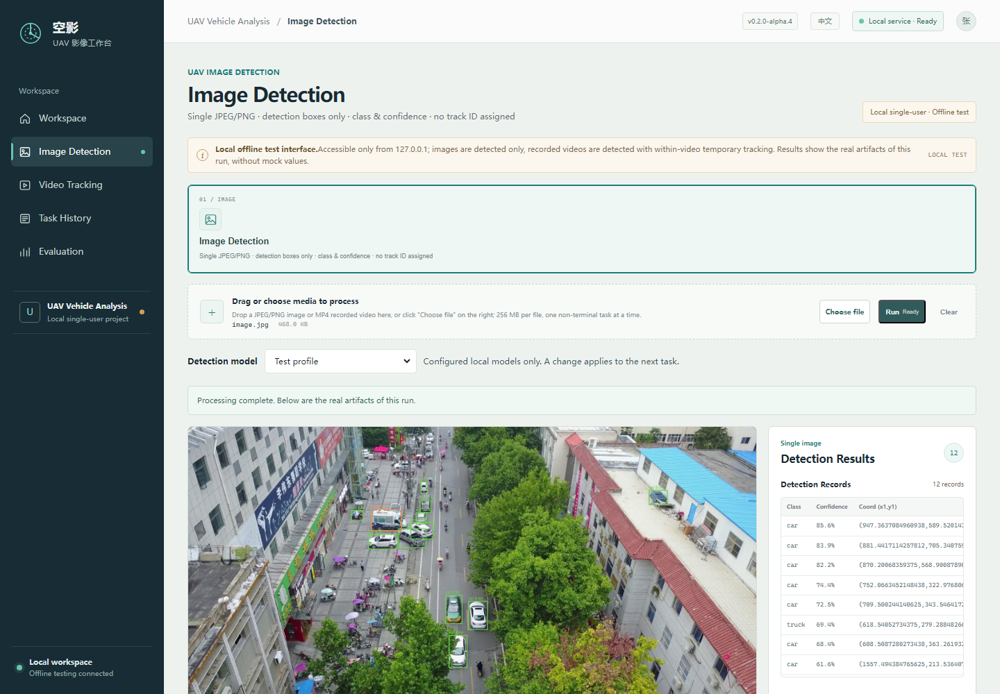
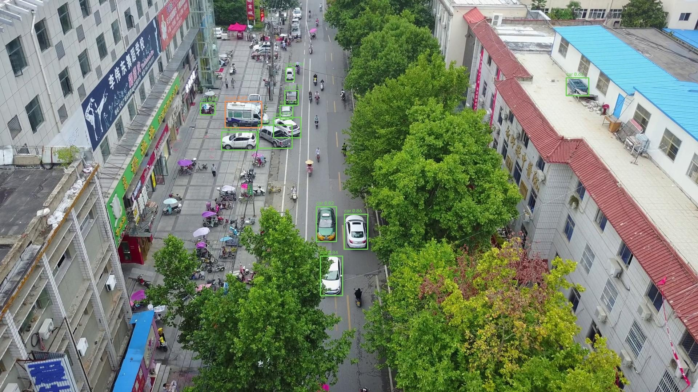
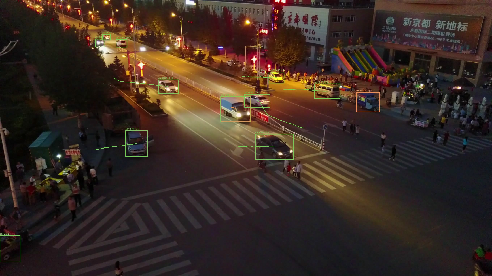

# 开发样例：图片检测与视频内跟踪

下方两张标注结果图来自 2026 年 11 月 19 日的本地 CPU 流水线运行。它们是程序实际生成的结果，不是手工绘制的示意图。图片经过 JPEG 压缩以便在仓库中查看；原始运行产物仍保存在本机。

## 前端页面

这是本地 Web 图片检测页的桌面截图，拍摄于 2026 年 11 月 20 日的 `0.2.0-alpha.4` 开发检查。截图中的 `Test profile` 是用于验证模型选择接口的测试配置名称，复用同一份 YOLO26l 权重；下方标注图和 12 条记录来自真实推理。侧栏列出了工作台、图片检测、视频跟踪、任务历史和评估页面，其中任务历史与评估页面仍是静态占位页。截图显示本地后续界面版本；当前远端前端源码仍为 `0.2.0-alpha.3`，尚未同步模型选择接口。

## 图片检测

输入为 VisDrone2019-DET-val 的 `0000001_02999_d_0000005.jpg`。预训练 YOLO26l 在这张开发样本上输出 12 条车辆检测记录。程序为图片生成标注图与 `detections.csv`；图片不分配跟踪 ID。

## 视频内跟踪

这是 48 帧开发短片的第 24 帧（程序帧索引 23），从真实生成的 `annotated.mp4` 提取。输入来自 VisDrone2019-MOT-val 序列 `uav0000117_02622_v`。检测器仍为预训练 YOLO26l，ByteTrack 只在这段视频内关联检测。框旁的 ID 是临时编号；轨迹线表示图像平面的观测，不证明真实身份或物理速度。

两次运行均返回 `SUCCEEDED`，推理参数为 `imgsz=640`、`conf=0.25`、`iou=0.7`。这些样本只展示链路能够产生实际结果，不代表代表性准确率、官方 VisDrone 分数、性能目标达成或正式系统验收。原始数据、权重、完整视频和运行目录没有上传。

样本来源与版权归 [VisDrone / AISKYEYE 团队](https://github.com/VisDrone/VisDrone-Dataset)。展示图片基于其数据生成，仅用于本私有仓库的课程开发记录；原数据使用条件见[官方说明](https://aiskyeye.com/data-protection/)。项目对 2019 数据包的具体许可适用性仍在核验，未经确认不公开分发这些衍生图片。

